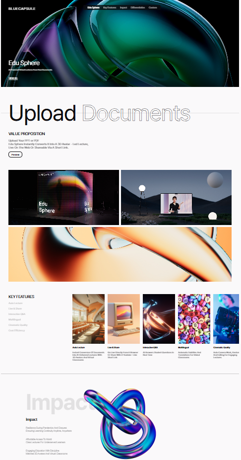
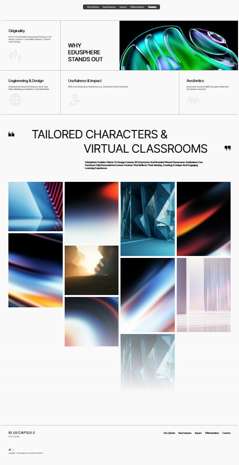

# AIVS · Edu Sphere

**AI 교육 서비스의 가치를 영상과 이미지, 섹션 탐색 인터랙션으로 전달하는 웹 소개 페이지를 구현.**

Next.js App Router와 React, TypeScript를 기반으로 단일 페이지를 구성했으며, SCSS Modules와 Swiper를 활용해 브랜드 중심의 화면과 카드 슬라이더를 구현.

[원본 소스 저장소](https://github.com/saintlucias/Aivs-Template-not-used-server-) · [포트폴리오 저장소](https://github.com/saintlucias/Aivs-Web-Portfolio)

## 프로젝트 개요

| 항목 | 내용 |
| --- | --- |
| 프로젝트명 | AIVS · Edu Sphere |
| 유형 | 교육 서비스 소개용 프런트엔드 웹 템플릿 |
| 화면 구성 | Edu Sphere · Key Features · Impact · Differentiation · Custom |
| 구현 범위 | 단일 페이지 UI, 영상 배경, 섹션 탐색, 카드 슬라이더, 이미지 갤러리를 구현. |
| 렌더링·배포 구성 | Next.js의 정적 내보내기 설정을 적용. |
| 분석 기준 | 원본 커밋 [`94419a3`](https://github.com/saintlucias/Aivs-Template-not-used-server-/tree/94419a3d22668753f6db7d5471e5144d00b35a94)을 기준으로 작성. |

이 저장소에는 프로젝트 분석 README와 원본 저장소에서 가져온 화면 이미지를 정리. 애플리케이션 실행 코드는 원본 소스 저장소에서 관리.

## 화면 미리보기

원본 저장소의 README에 포함된 화면 이미지를 첨부.

### 상단 · 서비스 소개와 주요 기능



### 하단 · 차별점과 커스텀 갤러리



## 사용 기술과 스택

아래 버전은 원본 저장소의 `package-lock.json`에 기록된 설치 버전을 기준으로 정리.

| 구분 | 기술 · 버전 | 적용 내용 |
| --- | --- | --- |
| 프레임워크 | Next.js 15.5.0 | App Router의 `page.tsx`와 `layout.tsx`로 페이지 진입점과 공통 레이아웃을 구성. |
| UI | React 19.1.0 · React DOM 19.1.0 | 컴포넌트 조합, Props 전달, 상태 관리와 이벤트 처리에 사용. |
| 언어 | TypeScript 5.9.2 | Props와 콘텐츠 데이터에 인터페이스 및 유니언 타입을 적용했으며 `strict` 설정을 활성화. |
| 스타일 | Sass 1.90.0 · SCSS Modules | 컴포넌트별 스타일을 분리하고 공통 변수와 믹스인으로 색상·글자 크기·폰트를 관리. |
| 슬라이더 | Swiper 11.2.10 | `Swiper`와 `SwiperSlide`로 주요 기능 카드를 가로로 탐색하도록 구성. |
| 개발·빌드 | Turbopack | `dev`와 `build` 스크립트에 `--turbopack` 옵션을 적용. |
| 코드 검사 | ESLint 9.33.0 · eslint-config-next 15.5.0 | Next.js Core Web Vitals 및 TypeScript 규칙을 설정. |
| 타이포그래피 | 로컬 Pretendard OTF | 9종 굵기의 폰트를 `@font-face`로 등록하고 공통 믹스인에서 사용. |
| 정적 자산 | JPG · PNG · SVG · MP4 | 서비스 소개 이미지, 아이콘, 로고, 히어로 영상을 `public/`에서 제공하도록 구성. |

`scss` 0.2.4 패키지도 의존성에 선언되어 있으나, 스타일 파일은 `.scss`와 Sass의 `@use`·믹스인 문법을 중심으로 구성.

근거로 [패키지 설정](https://github.com/saintlucias/Aivs-Template-not-used-server-/blob/94419a3d22668753f6db7d5471e5144d00b35a94/package.json), [잠금 파일](https://github.com/saintlucias/Aivs-Template-not-used-server-/blob/94419a3d22668753f6db7d5471e5144d00b35a94/package-lock.json), [전역 스타일](https://github.com/saintlucias/Aivs-Template-not-used-server-/blob/94419a3d22668753f6db7d5471e5144d00b35a94/src/app/globals.scss)을 확인.

## 주요 구현 기능

| 기능 | 구현 방식 |
| --- | --- |
| 히어로 영상 배너 | 로컬 MP4를 배경으로 배치하고 `autoPlay`, `muted`, `loop`, `playsInline`을 지정. |
| 고정 내비게이션 | 화면 상단에 메뉴를 고정하고 5개 섹션으로 이동하는 버튼을 구성. |
| 부드러운 섹션 이동 | 메뉴 클릭 시 대상 ID를 조회하고 `scrollIntoView({ behavior: 'smooth' })`를 호출하도록 구현. |
| 현재 섹션 표시 | `IntersectionObserver`와 React 상태를 연결하고 관찰 대상의 교차 비율 임계값을 `0.5`로 설정. |
| 주요 기능 카드 슬라이더 | `sliderData`의 6개 항목을 반복 렌더링하고 `spaceBetween={24}`, `slidesPerView="auto"`를 적용. |
| 가치 제안 영역 | 대형 타이틀, 설명, Preview 버튼을 재사용 컴포넌트로 조합. |
| 이미지 그리드 | CSS Grid로 상단 이미지 2개와 하단의 넓은 이미지 1개를 배치. |
| Impact · Differentiation | 동일한 `Impact` 컴포넌트에 데이터와 `typeA`·`typeB` 변형을 전달해 두 영역을 구성. |
| 차별점 콘텐츠 | 아이콘과 제목·설명을 담은 `CardB` 및 이미지 블록을 조합. |
| Custom 갤러리 | 4개의 `ColumnImages`에 이미지 배열을 전달해 높이가 다른 이미지를 열 단위로 배치. |
| 푸터 | 브랜드 로고, 저작권 문구, 섹션 이름을 표시하도록 구성. |

화면 조합은 [AivsMain](https://github.com/saintlucias/Aivs-Template-not-used-server-/blob/94419a3d22668753f6db7d5471e5144d00b35a94/src/app/components/layout/main/AivsMain.tsx), 탐색 로직은 [useScrollSection](https://github.com/saintlucias/Aivs-Template-not-used-server-/blob/94419a3d22668753f6db7d5471e5144d00b35a94/src/app/hooks/useScrollSection.ts), 카드 탐색은 [CardSlider](https://github.com/saintlucias/Aivs-Template-not-used-server-/blob/94419a3d22668753f6db7d5471e5144d00b35a94/src/app/components/expansion/card-slider/CardSlider.tsx)에서 확인.

## 시각 효과와 구현 의도

| 효과 | 적용 방식과 의도 |
| --- | --- |
| 영상 중심의 첫 화면 | 배경 영상을 `object-fit: cover`로 배치하고 그라데이션을 겹쳐 브랜드 분위기와 텍스트 대비를 표현. |
| 반투명 내비게이션 | 어두운 반투명 배경과 `backdrop-filter: blur(5px)`를 사용해 배경 위에서 메뉴를 구분하도록 구성. |
| 메뉴 활성 상태 | 비활성 메뉴에 `opacity: 0.5`를 적용해 현재 선택된 항목과 시각적 차이를 부여. |
| 대형 타이포그래피 | Pretendard 굵기와 크기, 낮은 투명도의 대형 제목을 조합해 정보의 위계를 표현. |
| 카드의 수평 탐색 | 긴 기능 목록을 이미지·제목·설명이 포함된 카드로 나누고 가로 슬라이더로 구성. |
| 비대칭 이미지 구성 | CSS Grid와 Flexbox를 함께 사용해 이미지 크기와 배열에 변화를 부여. |
| 갤러리 하단 페이드 | 배경색으로 이어지는 `linear-gradient` 오버레이를 배치해 이미지 영역이 점차 흐려지는 효과를 구현. |

위 내용은 코드에서 확인한 표현 방식과 구현 의도를 정리했으며, 전환율·로딩 속도·비용 절감에 관한 별도 측정 결과는 원본 저장소에서 확인하지 못했음.

## API와 데이터 처리

### 사용한 브라우저·라이브러리 API

| API | 사용 목적 |
| --- | --- |
| `IntersectionObserver` | 섹션의 화면 진입을 관찰하고 활성 메뉴 ID를 갱신하도록 구현. |
| `document.getElementById()` | 내비게이션 데이터의 ID에 대응하는 DOM 요소를 조회. |
| `Element.scrollIntoView()` | 버튼 클릭 시 해당 섹션으로 부드럽게 이동하도록 구현. |
| React `useState` · `useEffect` | 활성 메뉴 상태와 관찰자 등록을 관리하고 언마운트 시 `unobserve()`를 호출하도록 구현. |
| Swiper React API | 데이터 배열을 슬라이드로 변환해 카드 탐색 UI를 구성. |
| `next/image` | 이미지 컴포넌트를 사용했으며 정적 내보내기에 맞춰 전역 `unoptimized: true`를 설정. |
| HTML `<video>` | 서버 스트리밍 연동 없이 로컬 MP4를 배경 영상으로 재생하도록 구성. |

### 외부 API·서버 연동 범위

분석한 소스에서 `fetch`·Axios 기반 외부 API 호출, Route Handler, Server Action, 데이터베이스 및 인증 연동은 확인되지 않았음. 화면에 필요한 텍스트·이미지 경로·메뉴 정보는 `src/app/constants/`의 정적 데이터로 관리.

AI 강의 생성, 문서 업로드·변환, 실시간 Q&A, 자동 번역, 라이브 공유는 페이지가 소개하는 서비스 콘셉트이며, 해당 기능의 처리 로직이나 API 연동은 이 저장소에서 확인되지 않았음. 소개 문구의 “최대 90% 비용 절감”도 측정 근거가 제공되지 않아 프로젝트의 검증된 성과로 기재하지 않았음.

서비스 소개 내용은 [sliderData](https://github.com/saintlucias/Aivs-Template-not-used-server-/blob/94419a3d22668753f6db7d5471e5144d00b35a94/src/app/constants/slider.ts)와 [contentsData](https://github.com/saintlucias/Aivs-Template-not-used-server-/blob/94419a3d22668753f6db7d5471e5144d00b35a94/src/app/constants/contents.ts)를 기준으로 구분.

## 컴포넌트 구조와 데이터 흐름

```text
src/app/
├── page.tsx                      → 페이지 진입점
├── layout.tsx                    → 메타데이터와 공통 문서 구조
├── globals.scss                  → 초기화, 폰트, Swiper 공통 스타일
├── components/
│   ├── basic/                    → Button, Title, Description, CardA, CardB 등
│   ├── expansion/                → CardSlider, Impact, ContentsBox, ColumnImages 등
│   ├── module/                   → Navbar, Banner, Features, Edge, Footer 등
│   └── layout/main/AivsMain.tsx   → 전체 섹션 조합
├── constants/                    → 메뉴, 카드, 이미지, 영상, 푸터 데이터
├── hooks/useScrollSection.ts     → 섹션 이동과 활성 메뉴 상태
└── styles/                       → 공통 디자인 변수와 레이아웃 믹스인

public/
├── fonts/                        → Pretendard 로컬 폰트
├── image/                        → 화면 이미지와 아이콘
├── video/                        → 히어로 배경 영상
└── gif/                          → 저장소에 포함된 GIF 자산
```

기본 UI를 `basic`, 복합 UI를 `expansion`, 페이지 섹션을 `module`, 전체 조합을 `layout`으로 분리. `constants`의 배열을 `map()`으로 렌더링하고 Props로 전달해 콘텐츠와 표시 구조를 분리.

상호작용이 필요한 상태는 커스텀 훅에서 관리하고, `Navbar`가 훅의 상태와 이동 함수를 버튼에 전달하도록 구성. TypeScript 인터페이스와 유니언 타입으로 데이터 형태와 컴포넌트의 스타일 변형을 명시.
